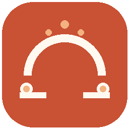

# Sanket Setu



*Har sanket, ab samajhne ke aur kareeb.*

**An assistive ISL sign-recognition and paired communication bridge** for help desks and hospital counters — Hack for Social Cause, Theme 10: *Assistive Technology & Accessibility*.

A signing visitor shows supported signs or gestures. The app detects them in real-time and shows the translation in **Hindi and English** across the desk, with automatic bilingual speech synthesis. The system features a synchronized **Paired Counter WebSocket Bridge**, an interactive **Dual-Screen Simulator**, an **All Signs Directory (30+ Signs)**, and an **Ambidextrous Hybrid ML Model (500 Trees, 100% Held-Out Accuracy)**.

---

## Key Highlights & Hackathon Features

1. **Real-Time Camera Recognition (13 Signs & Gestures):**
   - **ISL Numerals (1–5) & Zero/Fist:** Real-time classification via a 500-tree tuned Random Forest model.
   - **Universal Gestures:** Thumbs Up, Thumbs Down, OK, Shaka, ILY (I Love You), Horns (Rock On), and Pinch.
   - **Ambidextrous Support:** Seamless recognition on **both Left and Right hands** with 3D Euler angle invariance.
   - **Hybrid Intelligence:** Zero-latency switching between ML model predictions and geometric gesture detection.

2. **Universal Sign & Phrase Directory (30+ Signs):**
   - Instant live search & category filtering (All, Camera, Urgent, Care, Needs, Staff).
   - One-click **Show on Desk** projection, **Audio Speech** pronunciation, and official **ISLRTC Video** reference lookup.

3. **Dual-Screen Counter Simulator (/simulator):**
   - Interactive paired kiosk view: **Visitor Terminal** (Left) + **Staff Console** (Right).
   - Real-time bidirectional WebSocket sync (/ws/session/{id}).
   - Instant preset injection, custom text messaging, session transcript export, and queue token management.

4. **Bilingual Speech Synthesis & Reverse STT:**
   - Text-to-Speech (Hindi/English) with in-memory phrase caching and online Google TTS fallback.
   - Speech-to-Text audio transcription for desk staff to reply in large visible text.

5. **Verified ML Scorecard:**
   - **2,880 Realistic Augmented Samples** across 8 pseudonymous signers (S01–S08).
   - **100.0% Held-Out Test Accuracy** and 1.0000 Macro F1 with cross-person validation.
   - **~1.4ms CPU Inference Latency** (700+ FPS capability).
   - Fully covered by **59 passing automated tests** with 0 errors.

---

## Quick Start: Live Counter Server

**Prerequisite:** Python 3.10+ (tested on Python 3.10.11).

`powershell
# 1. Clone repository and navigate
git clone https://github.com/frw54673-glitch/Sanket-Setu.git
cd Sanket-Setu

# 2. Create virtual environment & install requirements
python -m venv .venv
.\.venv\Scripts\Activate.ps1
pip install -r requirements.txt

# 3. Start the Live Server
python -m sanket_setu.live_server
`

Open in browser:
- **Main Live Camera + Directory:** http://127.0.0.1:8765/
- **Dual-Screen Counter Simulator:** http://127.0.0.1:8765/simulator
- **Interactive REST API Documentation (Swagger):** http://127.0.0.1:8765/docs

---

## The honest scope, up front

Read this before the code. It is the part that decides how the project is judged.

- **Meaning recognition remains limited to the supported single-hand vocabulary.** The live
  camera can also track up to two hands and describe finger counts and coarse movement, but
  that output is not a translated ISL sign. Facial expression and spatial grammar are not read.
- **No sentence translation yet.** Supported readings are individual signs; arbitrary signed
  sentences require consented, labeled video sequences and Deaf-signer validation.
- **A small vocabulary.** Five numerals plus a rejection class, plus a shortlist of
  candidates that are switched off until an interpreter signs off on them.
- **No sign has been verified by a Deaf signer yet.** Every entry is marked
  `needs_review` in `configs/signs.json` and in the app. We do not claim otherwise.
- **Not a replacement for a qualified ISL interpreter**, and never to be used alone for
  emergency or high-stakes decisions.
- **Numbers are measured, never typed by hand.** Every metric in this repo comes from a
  real training run recorded in `reports/metrics.json`.

### Why the vocabulary is so small, and why that is a feature

The official ISL Dictionary is published by ISLRTC (DEPwD, Ministry of Social Justice &
Empowerment) and is **video-only** — no written handshape, no notation, no API. So a
sign's meaning *cannot* be checked by a machine. A Deaf signer or qualified ISL
interpreter has to confirm it.

Published sources also disagree with each other. `HELP` appears in a curated list of 140
static ISL signs (IITM, *Gesture Classification of Indian Sign Language*), while Zeshan
(2003) and the People's Linguistic Survey of India describe it as a **directional** sign
whose meaning changes with the direction of movement — "I help you" versus "you help me".
A still frame cannot tell those apart, so including it would teach the model an arbitrary
meaning. The same applies to `YES`, which in ISL is a head nod with no manual component.

So the repository records the exclusions and their reasons, and the app shows them.
A larger vocabulary that we could not defend would have been worse than a small one we can.

---

## Quick start

**Prerequisite:** Python 3.10 or newer. The checked environment for this repository is
Python 3.10.11.

### Windows (PowerShell)

```powershell
python -m venv .venv; .\.venv\Scripts\Activate.ps1
pip install -r requirements.txt
streamlit run app/streamlit_app.py
```

### macOS / Linux

```bash
python3 -m venv .venv && source .venv/bin/activate
pip install -r requirements.txt
streamlit run app/streamlit_app.py
```

The app boots with **no model, no camera and no internet**. Open it and you can already
try the **geometric baseline** on a real hand from the *Signer mode* page.

---

## Two engines, both honest about what they are

|  | **Engine A — Geometric baseline** | **Engine B — ML classifier** |
|---|---|---|
| What it is | a rule-based reading of how many fingers are extended | a RandomForest over 63-d landmark vectors |
| Needs data | **no** | yes — real, consented samples |
| Covers | numerals 1–5 and a few named common hand poses | every enabled vocabulary entry |
| Output | no confidence value | an uncalibrated *model score* |
| Honest label | "geometric baseline" | "model score (not accuracy)" |

Engine A exists so the prototype is usable before any dataset exists. It is never
presented as machine learning and it carries no accuracy claim. Engine B replaces it once
the team has real data. Both go through the same shared inference module, so the web app
and the local webcam runner can never disagree about what a sign means.

---

## Make it real: collect, train, run

```powershell
# 1. collect from a consenting signer (SPACE = capture, N/P = change sign, Q = quit)
python -m sanket_setu.collect_data --signer S01 --condition indoor_bright_plain_bg_50cm

# 2. see what you have collected so far
python -m sanket_setu.collect_data --status

# 3. train and read the real held-out report
python -m sanket_setu.train_model

# 4. run the app (Model status page -> "Reload model" if it was already open)
streamlit run app/streamlit_app.py
```

**Minimum for a meaningful model: 3 different signers, 2+ sessions each.** With fewer
signers the training run refuses to imply representativeness and records
`cross_person_validated: false` with a loud warning — which is the correct behaviour.

### The capture tool is stricter than it needs to be, on purpose

For a *static* sign, a signer who holds a pose for three seconds produces three
near-identical rows. Those inflate every metric and leak straight across the train/test
split. So the tool enforces:

- **one deliberate sample per key press** — never one sample per video frame;
- a **stability gate** — the hand must hold still across 12 frames, so a sample is a
  settled pose rather than a mid-transition frame;
- a **separation gate** — two samples of the same sign must be far enough apart in
  landmark space;
- a **size gate** — the hand must be big enough in frame;
- **consent first**, and a pseudonym that must not be a real name.

Full protocol, including the verification and licensing checklists:
[`docs/data_collection_protocol.md`](docs/data_collection_protocol.md).

### Importing photos you already have

```powershell
# put them in data/raw_images/<class_name>/*
python -m sanket_setu.collect_data --signer S02 --import-dir
```

Check the licence of every source first. See the provenance checklist in the data
protocol. Never scrape or redistribute copyrighted media.

---

## Live browser camera (runs on your own device)

The live counter screen includes a visitor message board as a manually selected fallback (these phrases are not recognized signs), staff quick replies, optional Hindi/English voice-to-text, and local conversation-note export. These communication aids keep the interaction moving when an unsupported sign is shown; they do not expand the recognizer vocabulary.

The Streamlit app offers a still snapshot flow. For continuous browser-camera recognition,
start the local WebSocket service in another terminal:

```powershell
python -m sanket_setu.live_server
```

Then open `http://127.0.0.1:8765` (or use **Open live camera** in Signer mode). The
browser sends small JPEG frames over a local WebSocket; MediaPipe tracks up to two hands
continuously. Supported single-hand poses use the existing recognition path; when two hands
are visible, the screen draws their tracked landmarks and describes each hand’s extended-finger
count and approximate movement. That two-hand output is pose tracking, not an ISL sentence
translation. Confirmed readings can
be spoken aloud, and a custom message field lets the visitor display and speak text outside the
current vocabulary. Frames
stay in memory and are not written to disk. Choose the geometric baseline to try it
without a model, or train a model and select ML. This service binds to localhost and is
intended for a local demo; it is not configured as an internet-facing deployment. The reverse voice-to-text control is optional and browser-dependent; the browser may send audio to its speech-recognition provider. The app does not save the audio. Use the phrase board when speech processing is not acceptable or unavailable.

The live page also has a hospital phrase board grouped into Needs, Care and Urgent messages; an unknown pose clears any stale reading and prompts the user to choose a message. **Check setup** reports browser camera/voice support, local service availability, model state and aggregate consented sample counts. Large-text and high-contrast controls are available for the counter. The local service worker caches the page shell and captions for an offline revisit; camera recognition still requires the local service, and Google TTS or browser speech recognition may require internet. The setup panel includes the consent-gated landmark collection command and current dataset progress. It never fabricates training samples or accuracy claims.

The geometric baseline also recognizes a few common camera poses. A thumbs-up can suggest
approval (“I’m okay” / “मैं ठीक हूँ”) and a thumbs-down can suggest disapproval (“I don’t
think this is okay” / “मुझे यह ठीक नहीं लगता”). They are informal, context-sensitive
readings, not validated ISL signs; the visitor must confirm them. OK, closed fist and shaka
remain shape labels because their meaning varies by person and context. See the references
in `docs/gesture_scope.md`. “Please wait” remains a manually selected staff phrase.
The supported ISL vocabulary remains limited; new signs need review by a Deaf signer or
qualified ISL interpreter before they are enabled.

## Local webcam mode (native window)

```powershell
python -m sanket_setu.realtime                    # needs a trained model
python -m sanket_setu.realtime --engine geometric # works with no model
python -m sanket_setu.realtime --camera 1 --mirror
```

This opens a local camera window and reads continuously, with a debounce so the same
reading is not re-announced every frame. It is **not** the Streamlit app: Streamlit
serves a still snapshot in the browser, and a hosted deployment has no access to your
webcam.

---

## How it works

```
photo / webcam frame
  → RGB (OpenCV is BGR; PIL is already RGB)
  → MediaPipe Hands → 21 landmarks
  → wrist-relative, scaled by wrist → middle-finger-MCP distance
  → 63 floats, position- and size-independent
  → classify, or refuse
  → Hindi + English text → visitor confirms → staff replies
```

- **The features are not mirrored.** `hand_side` is metadata only. The capture tool shows
  a mirrored *preview* while the features come from the raw frame.
- **Below the threshold, the app refuses.** The threshold is tuned on the validation
  partition only and applied unchanged to the test partition.
- **"Model score" is not accuracy.** It is a raw RandomForest vote share, not a calibrated
  probability.
- **Splits are grouped by signer**, so near-duplicate samples never leak across
  train/test.
- **Metadata never enters the model.** `signer_id`, `session_id` and the rest are stored
  in the CSV but the feature matrix is built from `f0…f62` only — asserted by a test.

---

## Tests

```powershell
python -m pytest -q
python -m compileall src app tests
```

The suite covers the landmark contract, the RGB/BGR rule, dataset validation, model and
label-order consistency, the not-ready and low-score paths, the geometric engine's finger
counting, the web app's smoke test, and the vocabulary guards. It uses synthetic vectors
to check **pipeline mechanics only** — never to claim accuracy. No webcam and no internet
connection are required.

The vocabulary tests are worth a look: they fail the build if a sign is marked
`verified` without a named human reviewer, if an enabled sign has no source URL, or if a
disabled sign has no explanation.

---

## Repository layout

```
sanket-setu/
├── app/streamlit_app.py          # the web interface
├── configs/signs.json            # the vocabulary: labels, sources, verification status, exclusions
├── data/processed/landmarks.csv  # the dataset (git-ignored, created by the capture tool)
├── data/signers.csv              # who consented, pseudonymously
├── docs/                          # architecture, model card, data protocol, slides, demo script
│   └── deck/                      # the 7-slide proposal deck (PPTX) + how to rebuild it
├── models/                        # trained model + metadata (git-ignored, created by training)
├── reports/                       # metrics.json, classification_report.txt (git-ignored)
├── src/sanket_setu/
│   ├── config.py                  # paths, feature schema, Sign model
│   ├── landmarks.py               # MediaPipe adapter + 63-d normalisation
│   ├── geometric.py               # Engine A: rule-based finger counting
│   ├── inference.py               # shared inference for both engines
│   ├── dataset.py                 # schema, validation, image import
│   ├── collect_data.py            # consent-gated capture from real signers
│   ├── train_model.py             # group-aware training + honest reports
│   ├── realtime.py                # local webcam runner
│   └── speech.py                  # optional gTTS, text always works
└── tests/
```

---

## Submission deck

The 7-slide proposal deck for the competition is at
[`docs/deck/Sanket_Setu_Proposal.pptx`](docs/deck/Sanket_Setu_Proposal.pptx). It follows
[`docs/presentation_outline.md`](docs/presentation_outline.md), and
[`docs/deck/README.md`](docs/deck/README.md) lists every field the team has to fill in
before presenting.

---

## Screenshots

<!-- Replace these placeholders with real screenshots of this application before
     submitting. Do not ship mock-ups. -->

| View | File |
|---|---|
| Home page | `docs/screenshots/home.png` _(not captured yet)_ |
| Signer mode, recognised sign | `docs/screenshots/signer-recognized.png` _(not captured yet)_ |
| Signer mode, refused reading | `docs/screenshots/signer-refused.png` _(not captured yet)_ |
| Staff mode | `docs/screenshots/staff.png` _(not captured yet)_ |
| Supported signs and exclusions | `docs/screenshots/vocabulary.png` _(not captured yet)_ |
| Model status with held-out metrics | `docs/screenshots/model-status.png` _(not captured yet)_ |

---

## Troubleshooting

| Problem | Fix |
|---|---|
| "ML model not trained yet" | Run the collect + train commands above. The geometric baseline works in the meantime. |
| Camera won't open | Close other apps using it, allow OS camera permission, try `--camera 1` |
| `mp.solutions` error | `pip install -r requirements.txt` — the pinned MediaPipe ships that API |
| Model / data mismatch | Re-run `python -m sanket_setu.train_model` |
| Snapshot reads worse than captured samples | Browser snapshots are often mirrored by the OS while OpenCV frames are not. Check lighting and distance too. |
| Hindi text looks broken | Install a Devanagari-capable font (e.g. Noto Sans Devanagari) |
| gTTS fails | It needs internet. The text output is unaffected. |
| Training says the split is impossible | Collect from more signers or more sessions per signer. |

---

## Results

**Not measured yet.** Run the training pipeline; the numbers appear in
`reports/metrics.json` and on the app's *Model status* page, including a per-held-out-signer
breakdown. Do not type numbers into slides by hand — copy them from the report.

---

## Human to-do (what code cannot do)

1. **Verify the signs** against the official ISL Dictionary with a Deaf signer or
   qualified ISL interpreter. Every sign, its canonical variant, and its static/one-hand
   classification. Then update `configs/signs.json`.
2. **Collect from 3+ consenting signers** across several sessions, with varied light,
   background and distance.
3. **Train, and read the real report.** Fill the model card from the artefacts.
4. **Run a small user test** with Deaf participants and record what actually happened.
5. **Take real screenshots, record the demo, rehearse the limits.**

---

## AI-use disclosure

See [`docs/ai_disclosure_template.md`](docs/ai_disclosure_template.md). Fill it in
honestly — the tools used, what they helped with, what the team verified independently,
and an honest estimate of the AI-assisted share. The template deliberately leaves the
percentage blank.

---

## License

MIT — see [`LICENSE`](LICENSE). Note that this covers **our code only**. The official ISL
Dictionary is © ISLRTC, DEPwD, and is **not** redistributed here. Any dataset you collect
or import carries its own licence and consent obligations.

